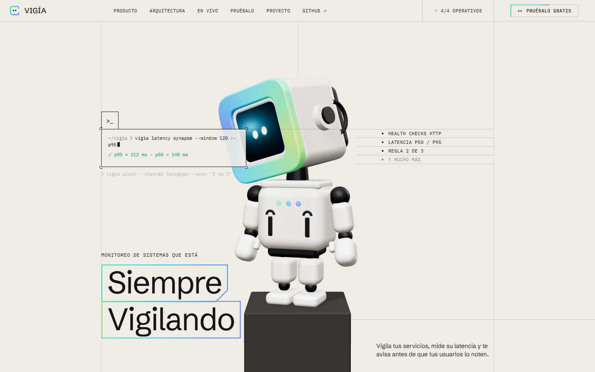
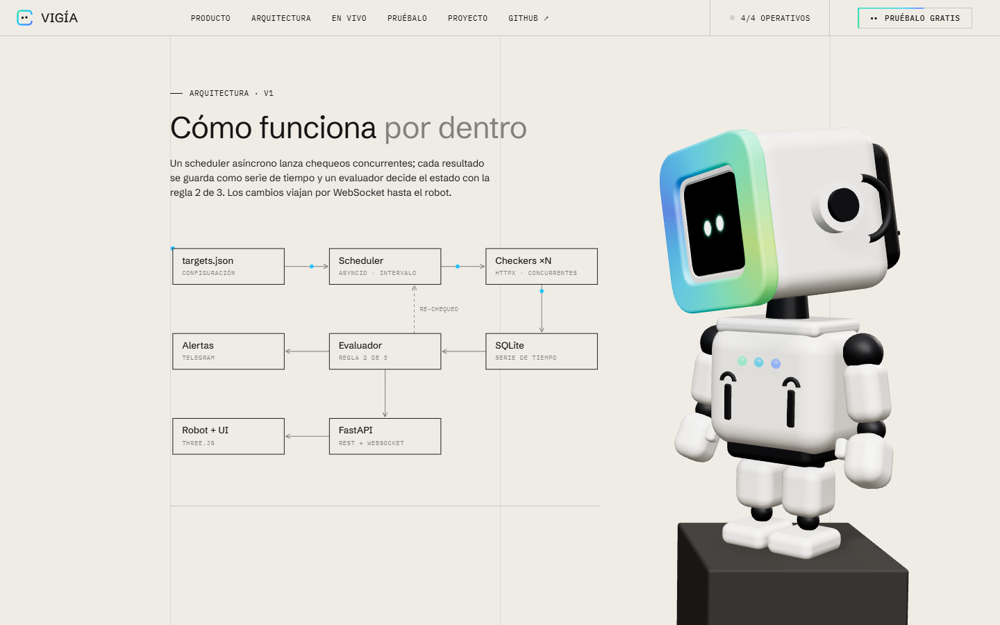
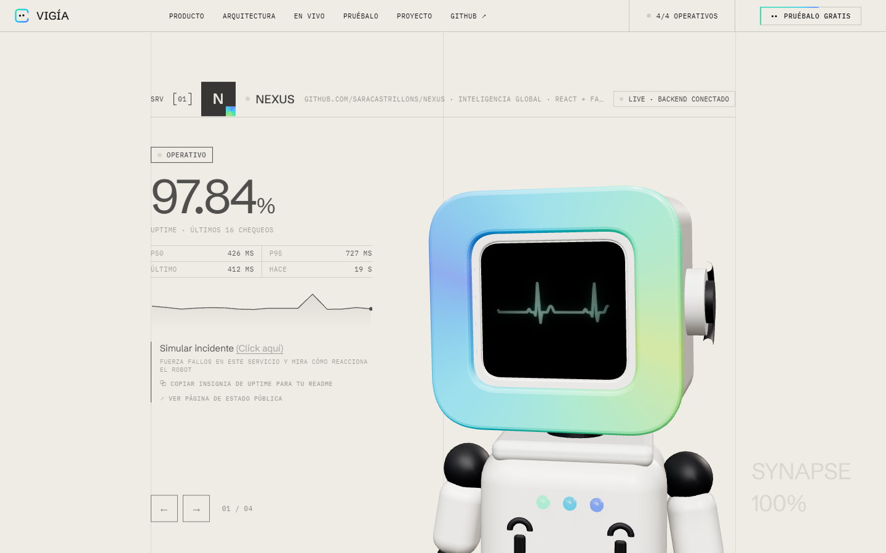
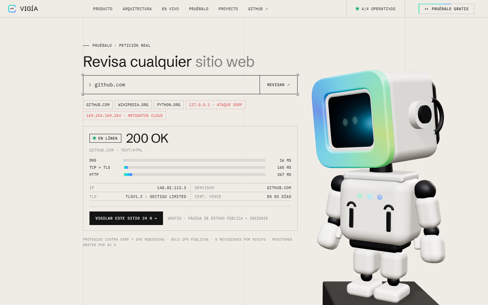
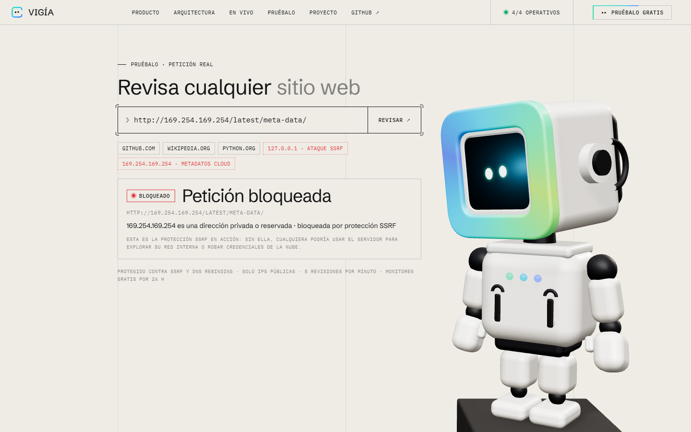
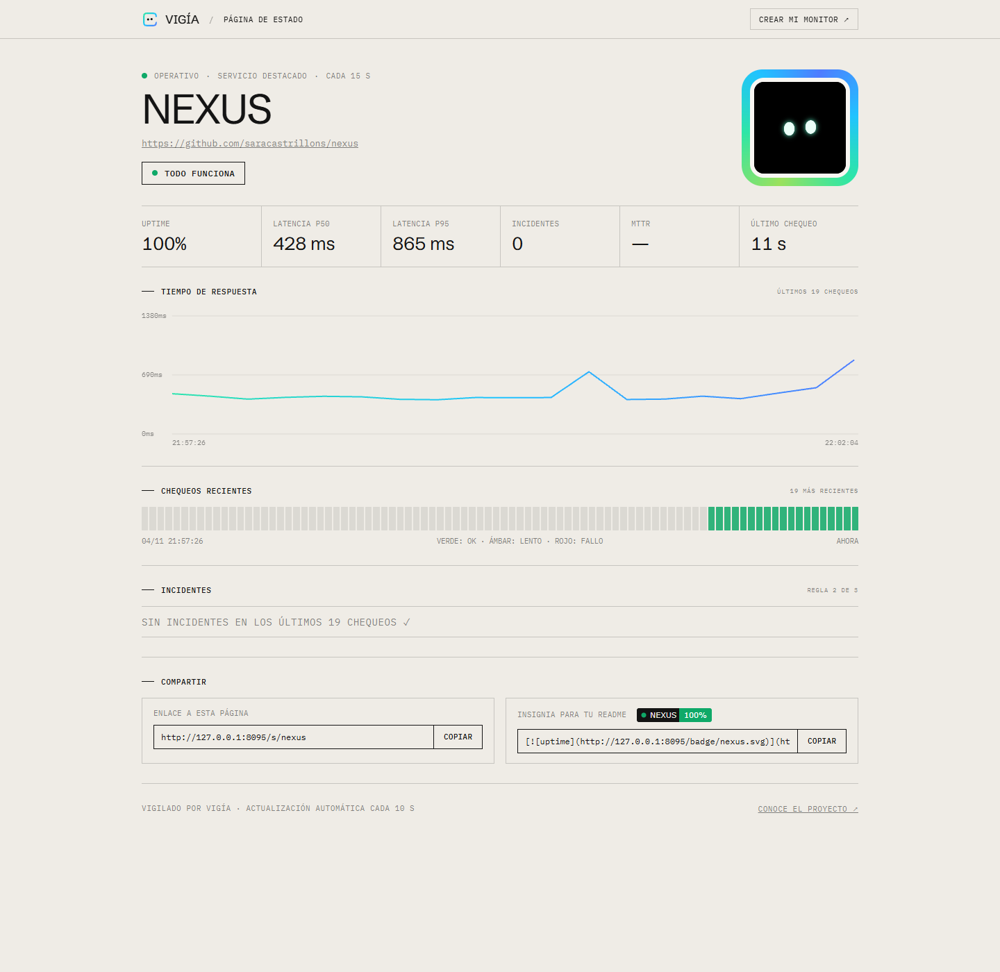
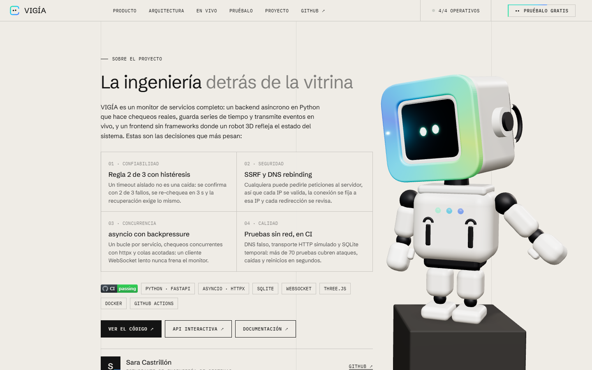

# VIGÍA · Monitoreo de sistemas

Monitor de servicios **autoalojado**: hace *health checks* HTTP concurrentes, guarda cada resultado como serie de tiempo, decide el estado con la **regla 2 de 3** y transmite cada evento por **WebSocket** a un robot 3D que reacciona en vivo al estado real de tus sistemas.



| Arquitectura | En vivo |
|---|---|
|  |  |
| **Pruébalo: revisión real de cualquier URL** | **Protección SSRF bloqueando metadatos de la nube** |
|  |  |
| **Página de estado pública de cada servicio** | **Sobre el proyecto** |
|  |  |

## ¿Qué hace?

- **Health checks HTTP** asíncronos (`httpx` + `asyncio`), con un bucle independiente por servicio.
- **Regla 2 de 3**: un servicio solo se declara caído si fallan 2 de sus últimos 3 chequeos. La recuperación exige lo mismo (histéresis), así que un timeout aislado no dispara alarmas.
- **Re-chequeo rápido**: al primer fallo vuelve a consultar en 3 s en lugar de esperar todo el intervalo.
- **Latencia p50 / p95** y **uptime** sobre una ventana móvil de 120 chequeos.
- **Historial en SQLite** (modo WAL e índice por servicio y tiempo), con retención de 30 días.
- **Eventos en tiempo real** por WebSocket, con colas acotadas: un cliente lento nunca bloquea al monitor.
- **Alertas por Telegram** solo cuando cambia el estado (caída y recuperación).
- **Autodiagnóstico**: VIGÍA se vigila a sí misma por `/healthz`.
- **Incidentes simulados** para demostrar el sistema. Se restauran solos a los 60 s.
- **Pruébalo**: cualquier visitante revisa una URL pública y ve el código HTTP, la IP, el servidor, la versión de TLS, cuándo vence el certificado y un *waterfall* con los tiempos de DNS, TCP+TLS y HTTP.
- **Protección SSRF**: solo http/https y puertos web, todas las IPs del dominio deben ser públicas, la conexión se hace a la IP ya validada (anti *DNS rebinding*), cada redirección se valida de nuevo y hay un límite de 5 revisiones por minuto por IP.
- **Crea tu propio monitor**: cualquier visitante puede vigilar su sitio gratis durante 24 h, sin cuenta. Recibe una página de estado pública y una insignia. Hay un límite de 3 monitores por IP y 50 en total, y el chequeo de cada uno revalida la IP en cada intento (protección SSRF continua). Solo quien lo creó puede borrarlo, con un token cuyo hash se guarda en SQLite.
- **Página de estado** (`/s/{id}`): uptime, p50/p95, gráfica interactiva de latencia, las últimas 90 casillas de chequeos, **historial de incidentes y MTTR** (tiempo medio de recuperación), enlace para compartir e insignia.
- **Insignias SVG en vivo** (`/badge/{id}.svg`) para mostrar el uptime en cualquier README.
- **Vista previa al compartir** (Open Graph): el link muestra imagen y descripción en LinkedIn, WhatsApp o X.
- **Calidad adaptativa**: si el equipo es lento, el robot desactiva sombras y resolución extra para mantener 60 fps. Las barras de circuito usan un `InstancedMesh` y la textura de la cara se sube a la mitad de resolución.
- **Robot 3D** (three.js, sin build) cuya cara, aro y LEDs cambian según el peor estado: ojos → ceño amarillo → "!" rojo.
- **Modo demo**: si la página se abre sin backend (por ejemplo, en GitHub Pages), simula los chequeos en el navegador con las mismas reglas.

## Arquitectura

```
targets.json ─► Scheduler (asyncio) ─► Checkers ×N (httpx)
                    ▲                        │
              re-chequeo                     ▼
                    │                     SQLite
Alertas ◄──── Evaluador 2 de 3 ◄─────────────┘
                    │
                    ▼
Robot + UI ◄── FastAPI (REST + WebSocket)
```

| Archivo | Rol |
|---|---|
| `app/evaluator.py` | Reglas puras: estado, percentiles, uptime |
| `app/monitor.py` | Bucles por servicio, probes, simulación y pub/sub |
| `app/store.py` | Persistencia en SQLite |
| `app/alerts.py` | Notificador de Telegram |
| `app/inspect.py` | "Pruébalo": revisión de URLs con protección SSRF y límite por IP |
| `app/badge.py` | Insignias SVG |
| `web/status.html` | Página de estado pública de cada servicio |
| `app/main.py` | API REST, WebSocket y sirve `web/` |
| `web/index.html` | Landing + robot 3D en un solo archivo |

## Ejecutar en local (Windows)

Haz doble clic en `start.bat`, o en PowerShell:

```powershell
py -m venv .venv
.venv\Scripts\python -m pip install -r requirements.txt
.venv\Scripts\python -m uvicorn app.main:app --port 8090
```

Luego abre http://127.0.0.1:8090.

### Con Docker

```bash
docker build -t vigia .
docker run -p 8090:8090 -v vigia-data:/data vigia
```

## API

| Método | Ruta | Descripción |
|---|---|---|
| GET | `/healthz` | Salud de VIGÍA |
| GET | `/api/services` | Estado de todos los servicios y configuración |
| GET | `/api/services/{id}` | Resumen de un servicio |
| GET | `/api/services/{id}/checks?limit=500` | Historial desde SQLite |
| POST | `/api/services/{id}/simulate` | `{"down": true}` simula un incidente |
| POST | `/api/inspect` | `{"url": "github.com"}` revisa una URL pública |
| GET | `/api/status/{id}` | Estado, incidentes y MTTR de un servicio |
| POST | `/api/monitors` | `{"url": "mi-sitio.com"}` crea un monitor de 24 h (devuelve `id` y `token`) |
| DELETE | `/api/monitors/{id}` | Borra tu monitor (cabecera `X-Monitor-Token`) |
| GET | `/s/{id}` | Página de estado pública |
| GET | `/badge/{id}.svg?metric=uptime\|latency\|status` | Insignia SVG en vivo |
| WS | `/ws` | Mensaje `hello` inicial y luego un evento `check` por chequeo |

La documentación interactiva está en `/docs` (Swagger).

## Configuración

Los servicios a vigilar se definen en `targets.json`. `{self}` se reemplaza por la URL de VIGÍA, y `slow_ms` permite un umbral de lentitud por servicio.

| Variable | Por defecto | |
|---|---|---|
| `VIGIA_INTERVAL` | `30` | Segundos entre chequeos |
| `VIGIA_RECHECK` | `3` | Segundos hasta re-chequear tras un fallo |
| `VIGIA_TIMEOUT` | `5` | Timeout HTTP en segundos |
| `VIGIA_SLOW_MS` | `800` | Umbral global de "degradado" |
| `VIGIA_DB` | `vigia.db` | Ruta de SQLite |
| `VIGIA_ALLOW_SIMULATE` | `true` | Permite el botón "Simular incidente" |
| `VIGIA_INSPECT_LIMIT` | `5` | Revisiones de "Pruébalo" por IP y minuto |
| `VIGIA_TRUST_PROXY` | `false` | Usar `X-Forwarded-For` (actívalo solo detrás de tu proxy, por ejemplo Render) |
| `VIGIA_GUEST_TTL_H` | `24` | Horas que dura un monitor de visitante |
| `VIGIA_GUEST_MAX_PER_IP` / `VIGIA_GUEST_MAX_TOTAL` | `3` / `50` | Límites de monitores de visitantes |
| `TELEGRAM_BOT_TOKEN` / `TELEGRAM_CHAT_ID` | — | Activan las alertas |

## Insignias para tu README

```markdown
[](https://TU-DOMINIO/#vivo)
```

En la sección "En vivo" hay un botón que copia este código ya listo.

## Pruebas

```powershell
.venv\Scripts\python -m pip install -r requirements-dev.txt
.venv\Scripts\python -m pytest -q
```

Hay 71 pruebas: reglas del evaluador, configuración, API, persistencia tras un reinicio, simulación de caída y recuperación, WebSocket, insignias y la protección SSRF (IPs privadas, DNS rebinding, redirecciones hacia la red interna y límite por IP), monitores de visitantes (privacidad, límites, expiración, borrado con token y persistencia), e incidentes con MTTR, todo sin depender de la red. GitHub Actions las ejecuta y construye la imagen Docker en cada push.

## Stack

Python 3.12+ · FastAPI · asyncio · httpx · SQLite · WebSocket · three.js 0.160 · HTML, CSS y JS sin framework · Docker · GitHub Actions

---

Diseñado y construido por **Sara Castrillón** · 2026
