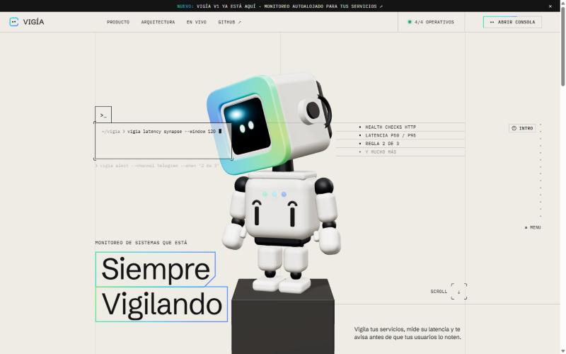
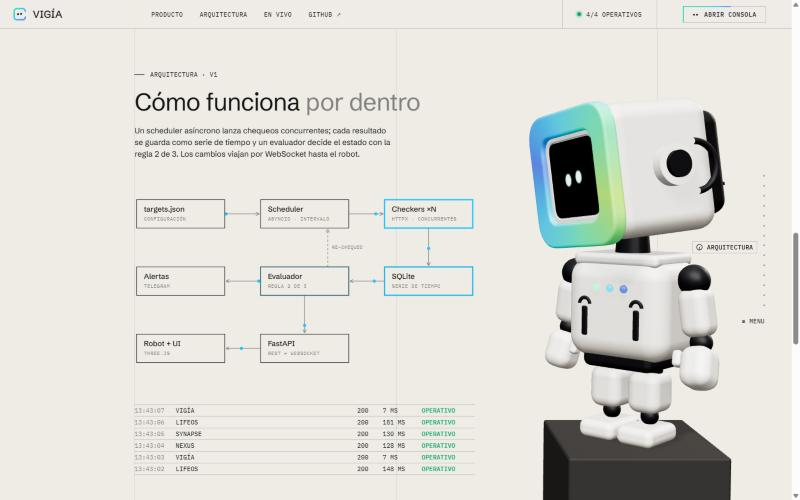
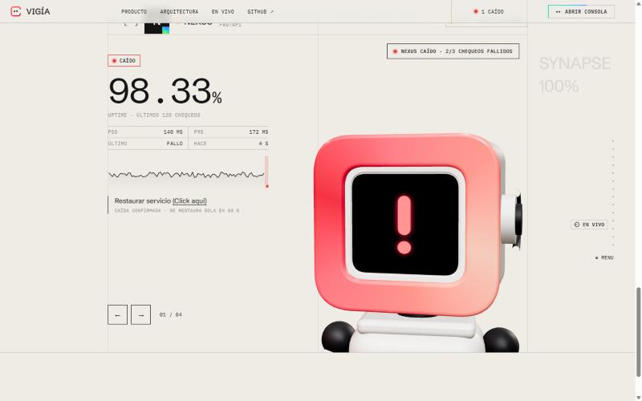

# VIGÍA · Monitoreo de sistemas

Monitor de servicios **autoalojado**: hace *health checks* HTTP concurrentes, guarda cada resultado como serie de tiempo, decide el estado con la **regla 2 de 3** y transmite cada evento por **WebSocket** a un robot 3D que reacciona en vivo al estado real de tus sistemas.



| Arquitectura | Incidente en vivo |
|---|---|
|  |  |

## ¿Qué hace?

- **Health checks HTTP** asíncronos (`httpx` + `asyncio`), con un bucle independiente por servicio.
- **Regla 2 de 3**: un servicio solo se declara caído si fallan 2 de sus últimos 3 chequeos. La recuperación exige lo mismo (histéresis), así que un timeout aislado no dispara alarmas.
- **Re-chequeo rápido**: al primer fallo vuelve a consultar en 3 s en lugar de esperar todo el intervalo.
- **Latencia p50 / p95** y **uptime** sobre una ventana móvil de 120 chequeos.
- **Historial en SQLite** (modo WAL e índice por servicio y tiempo), con retención de 30 días.
- **Eventos en tiempo real** por WebSocket, con colas acotadas: un cliente lento nunca bloquea al monitor.
- **Alertas por Telegram** solo cuando cambia el estado (caída y recuperación).
- **Autodiagnóstico**: VIGÍA se vigila a sí misma por `/healthz`.
- **Incidentes simulados** para demostrar el sistema. Se restauran solos a los 60 s.
- **Robot 3D** (three.js, sin build) cuya cara, aro y LEDs cambian según el peor estado: ojos → ceño amarillo → "!" rojo.
- **Modo demo**: si la página se abre sin backend (por ejemplo, en GitHub Pages), simula los chequeos en el navegador con las mismas reglas.

## Arquitectura

```
targets.json ─► Scheduler (asyncio) ─► Checkers ×N (httpx)
                    ▲                        │
              re-chequeo                     ▼
                    │                     SQLite
Alertas ◄──── Evaluador 2 de 3 ◄─────────────┘
                    │
                    ▼
Robot + UI ◄── FastAPI (REST + WebSocket)
```

| Archivo | Rol |
|---|---|
| `app/evaluator.py` | Reglas puras: estado, percentiles, uptime |
| `app/monitor.py` | Bucles por servicio, probes, simulación y pub/sub |
| `app/store.py` | Persistencia en SQLite |
| `app/alerts.py` | Notificador de Telegram |
| `app/main.py` | API REST, WebSocket y sirve `web/` |
| `web/index.html` | Landing + robot 3D en un solo archivo |

## Ejecutar en local (Windows)

Haz doble clic en `start.bat`, o en PowerShell:

```powershell
py -m venv .venv
.venv\Scripts\python -m pip install -r requirements.txt
.venv\Scripts\python -m uvicorn app.main:app --port 8090
```

Luego abre http://127.0.0.1:8090.

### Con Docker

```bash
docker build -t vigia .
docker run -p 8090:8090 -v vigia-data:/data vigia
```

## API

| Método | Ruta | Descripción |
|---|---|---|
| GET | `/healthz` | Salud de VIGÍA |
| GET | `/api/services` | Estado de todos los servicios y configuración |
| GET | `/api/services/{id}` | Resumen de un servicio |
| GET | `/api/services/{id}/checks?limit=500` | Historial desde SQLite |
| POST | `/api/services/{id}/simulate` | `{"down": true}` simula un incidente |
| WS | `/ws` | Mensaje `hello` inicial y luego un evento `check` por chequeo |

La documentación interactiva está en `/docs` (Swagger).

## Configuración

Los servicios a vigilar se definen en `targets.json`. `{self}` se reemplaza por la URL de VIGÍA, y `slow_ms` permite un umbral de lentitud por servicio.

| Variable | Por defecto | |
|---|---|---|
| `VIGIA_INTERVAL` | `30` | Segundos entre chequeos |
| `VIGIA_RECHECK` | `3` | Segundos hasta re-chequear tras un fallo |
| `VIGIA_TIMEOUT` | `5` | Timeout HTTP en segundos |
| `VIGIA_SLOW_MS` | `800` | Umbral global de "degradado" |
| `VIGIA_DB` | `vigia.db` | Ruta de SQLite |
| `VIGIA_ALLOW_SIMULATE` | `true` | Permite el botón "Simular incidente" |
| `TELEGRAM_BOT_TOKEN` / `TELEGRAM_CHAT_ID` | — | Activan las alertas |

## Pruebas

```powershell
.venv\Scripts\python -m pip install -r requirements-dev.txt
.venv\Scripts\python -m pytest -q
```

Hay 25 pruebas: reglas del evaluador, configuración, API, persistencia tras un reinicio, simulación de caída y recuperación, y WebSocket. GitHub Actions las ejecuta y construye la imagen Docker en cada push.

## Stack

Python 3.12+ · FastAPI · asyncio · httpx · SQLite · WebSocket · three.js 0.160 · HTML, CSS y JS sin framework · Docker · GitHub Actions

---

Diseñado y construido por **Sara Castrillón** · 2026
